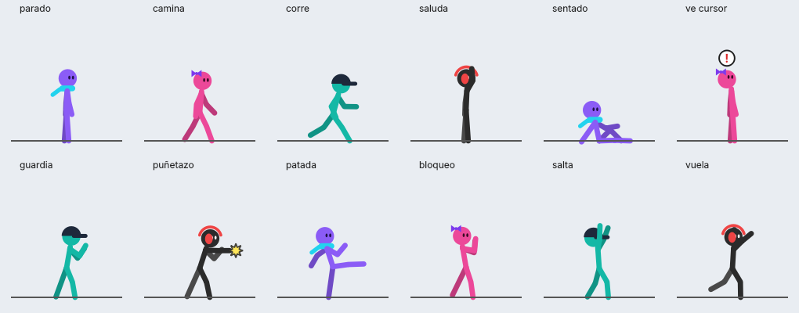

# Project Stickman

Stickmen animados que viven sobre tu barra de tareas de Windows. Caminan, corren, se sientan, saltan, se saludan, se pelean entre ellos y de repente notan tu cursor y lo persiguen.



## Cómo correrlo

```bash
pip install -r requirements.txt
python desk_stickmen.py
```

Aparecen 4 stickmen que caen desde arriba y aterrizan sobre la barra de tareas. Se controlan desde el ícono en la bandeja del sistema (agregar, quitar, pausar, ocultar, salir).

## Interacción

- **Arrastrar** con el mouse: lo agarras de la cabeza y lo puedes lanzar.
- **Clic**: saluda o salta.
- **Clic derecho**: órdenes (saludar, saltar, sentarse, correr, caminar, perseguir el cursor, pelear con otro, quitar).

## Comportamiento automático

- Deciden al azar entre caminar, correr, quedarse parados, sentarse, saludar, saltar o mirar el cursor.
- Si pasas el cursor cerca, a veces lo notan (aparece un **!**), lo miran y lo persiguen; si está justo arriba, saltan para atraparlo.
- Cuando dos se cruzan pueden saludarse o pelear (puñetazos, patadas, bloqueos y los golpes los mandan volando).
- Si los lanzas fuerte, al caer se quedan sentados un momento.

## Ajustes rápidos

Al inicio de `desk_stickmen.py`: `HEIGHT` (tamaño), velocidades, gravedad, `P_GREET` / `P_FIGHT` (qué tan seguido se saludan o pelean) y `ROSTER` (colores y accesorios de cada personaje).

## Elenco

Personajes originales: Uva (bufanda), Chicle (moño), Ola (gorra) y Tinta (audífonos).

---
Pancracio Studios
