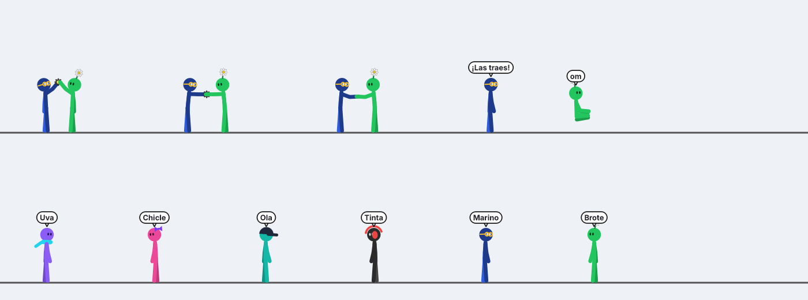

# Project Stickman

Stickmen animados que viven sobre tu barra de tareas de Windows. Caminan, hacen decenas de acciones, juegan en grupo, usan los objetos e instrumentos que les pongas, viven en las casitas que les armes, se pelean, se llaman por celular y persiguen tu cursor.

*Animated stickmen that live on your Windows taskbar. Available in Spanish and English (tray menu → Idioma / Language).*



## Cómo correrlo

Doble clic en **`Iniciar.bat`** (la primera vez instala PySide6 solo). O a mano:

```bash
pip install -r requirements.txt
python desk_stickmen.py
```

Al cerrar el programa se guardan los stickmen que estaban en pantalla, y la próxima vez que lo abras vuelven los mismos. Las construcciones (y lo que tienen adentro o pegado) también se guardan. Los objetos sueltos **no**: cada vez que abres el programa empiezan sin ellos.

## Menú de la bandeja (ícono junto al reloj)

- **Agregar stickman**: los originales o los de tu biblioteca.
- **Crear stickman personalizado…**: círculo cromático para el color del cuerpo, de los accesorios y de los ojos, brillo, nombre, 18 cosméticos combinables y dos tipos de cuerpo (normal o **cabeza grande hueca**). Hay un botón de 🎲 aleatorio.
- **Biblioteca de personajes**: tus personajes guardados. Desde aquí los pones en pantalla, los editas o los borras. También puedes **exportar un respaldo** a un archivo e **importarlo** después.
- **Objetos**: sofá, mesa con sillas, mesa de picnic, pelota, trampolín, columpio, resbaladilla, alberca inflable, fogata, asador, tele, cama, hamaca, escritorio con compu, caballete de pintura, pesas, barra de dominadas, caja, patineta, maceta, árbol, pizza y libro. Aparecen donde está tu cursor y los puedes arrastrar (la pelota la puedes lanzar). Clic derecho sobre un objeto para quitarlo.
- **Escenario de DJ** (en Cuartos y techos): escenario al aire libre con tornamesas, luces que parpadean al ritmo, bocinas y pantalla LED con la canción que suena. Reproduce **música al azar de tu PC** (MP3, WAV, OGG, FLAC, M4A…). Controles con clic derecho al escenario o en la bandeja → **Música del DJ**: reproducir/pausar, siguiente canción, detener y volumen; ahí mismo eliges de qué carpetas sale la música (Música/Descargas/Escritorio, las que agregues o toda la computadora). Cuando suena, uno sube a la cabina de DJ y todos los demás se juntan a brincar como en concierto.
- **Proyector y pantalla**: pasa fotos y GIFs animados de tu compu. En el menú **Fotos del proyector** eliges de dónde: Imágenes/Escritorio/Descargas (por defecto), las carpetas que agregues o toda la computadora. Con el evento **Presentación con proyector**, uno presenta con su puntero y los demás se sientan a ver y reaccionar. Si no encuentra fotos, presenta dibujos.
- **Instrumentos**: piano, batería, guitarra, trompeta, violín, micrófono (cantan) y bocina (bailan).
- **Cuartos y techos**: cuarto vacío, recámara, comedor, cocina, sala, estudio, baño, huerto, **cubo de escaleras** (se apila como un cuarto y conecta con el piso de arriba) y **escalera exterior**. Son cajitas que se **pegan de lado** cuando las sueltas cerca de otra y se **apilan** si sueltas una encima de otra (segundo piso). Ponles un **techo** (de dos aguas o plano) encima. Puedes meter objetos dentro de los cuartos, incluso en el segundo piso. Si hay escaleras, los stickmen suben por ellas, caminan por el piso de arriba y bajan igual; si no hay, trepan. Al mover un cuarto se mueve todo lo que tiene adentro y encima (objetos, cuartos de arriba y techo). Las construcciones y los objetos que estén dentro o pegados a un cuarto **se guardan** y vuelven al abrir el programa. Clic derecho a un cuarto para cambiar el color de la pared.
- **Idioma / Language**: español o inglés.
- **Juegos**: arranca un juego de grupo cuando quieras.
- Pausar, ocultar, salir.

## Clic derecho sobre un stickman

Órdenes rápidas, **Acciones** (todas), **Usar objeto**, **Jugar**, **Con otro…** (pelear, las traes, chocar los cinco, etc.), **Guardar en la biblioteca**, **Editar apariencia…**, **Duplicar** y **Quitar de la pantalla**.

Arrástralos con el mouse para lanzarlos; un clic los hace reaccionar.

## Lo que hacen solos

- **Más de 55 acciones solos**: yoga, malabares, lanzar avión de papel, helado, café, saltar la cuerda, burbujas, hula hula, yoyo, ballet, fotos, mortales, rueda de carro, pararse de manos, breakdance, moonwalk, baile robot, lagartijas, meditar levitando, dormir, karate, dab, volar como superhéroe, ver el celular, caminar viendo el celular, tomarse una selfie y muchas más.
- **Con objetos**: se sientan en el sofá (a veces con el celular), comen en la mesa de picnic, brincan en el trampolín con mortales, se calientan o asan bombones en la fogata, ven la tele, duermen en la cama, levantan pesas, hacen dominadas, se sientan en la caja, andan en patineta, riegan la planta (y crece), comen pizza (se va acabando), leen, patean la pelota, se columpian, se resbalan, chapotean en la alberca, pintan cuadros (el lienzo se va llenando), usan la compu, descansan en la hamaca o bajo el árbol y asan carne. Tocan todos los instrumentos. En la casa cocinan, sacan algo del refri, lavan trastes, comen o juegan cartas en el comedor, duermen en la recámara, se bañan, ven la tele en la sala y cosechan el huerto (las plantas crecen con el tiempo y al regarlas).
- **Juegos de grupo**: parkour en fila, saltar la cuerda (dos la mueven y los demás brincan), limbo con una vara que va bajando, béisbol (lanzador, bateador y jardineros), pasarse la pelota que tú les des, carreras, piedra papel o tijera, tira y afloja, salto de rana, conga y **hora de pintar** (pintan en caballetes y al final levantan su cuadro hacia la pantalla, felices).
- **Llamadas**: uno marca, al otro le suena el celular donde esté, contesta y platican.
- **Entre dos**: se saludan, chocan los cinco o los puños, se dan la mano, hacen reverencia, bailan juntos, juegan a las traes o se pelean (con combos, patadas voladoras, barridas, bloqueos y esquives).
- **Salen corriendo de la nada**, y de vez en cuando notan tu cursor y lo persiguen.

## Ajustes rápidos

En `stickmen/core.py`: `HEIGHT` (tamaño), velocidades, `ACTIVIDAD` (qué tan inquietos son), `SPRINT_CADA` (cada cuánto salen corriendo) y `ENCUENTRO` (qué tan seguido se saludan, juegan o pelean). En `stickmen/crew.py`: `JUEGO_CADA` (cada cuánto arman un juego de grupo).

## Dónde se guarda todo

En la carpeta `datos/` junto al programa:

- `sesion.json`: quiénes estaban en pantalla la última vez.
- `personajes.json`: tu biblioteca de personajes.
- `config.json`: el idioma.
- `musica.json`: carpetas de música y volumen.
- `proyector.json`: de qué carpetas salen las fotos.
- `construcciones.json`: cuartos, techos, escaleras y lo que tienen adentro.

## Código

| Archivo | Qué tiene |
|---|---|
| `desk_stickmen.py` | Punto de entrada |
| `stickmen/core.py` | Ajustes, elenco original, pantallas, poses y esqueleto |
| `stickmen/actions.py` | Todas las acciones animadas |
| `stickmen/draw.py` | Dibujo, cosméticos y objetos en la mano |
| `stickmen/stickman.py` | El comportamiento de cada stickman |
| `stickmen/objects.py` | Los objetos e instrumentos que colocas |
| `stickmen/rooms.py` | Cuartos modulares y techos |
| `stickmen/i18n.py`, `lang_en.py` | Idiomas |
| `stickmen/games.py` | Los juegos de grupo y las llamadas |
| `stickmen/creator.py` | El creador de personajes |
| `stickmen/storage.py` | Sesión, biblioteca y respaldos |
| `stickmen/crew.py` | El grupo, la bandeja y los menús |

---
Pancracio Studios
